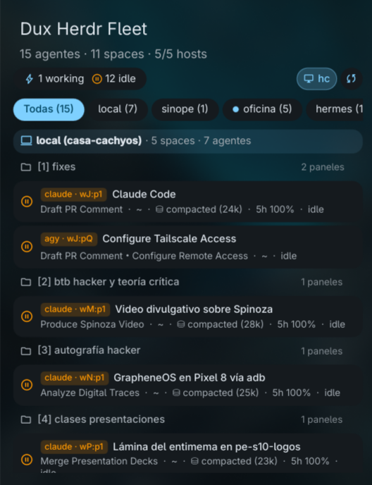

# Dux Herdr Fleet (`duxHerdrFleet`)

Multi-machine & workspace agent monitor for [DankMaterialShell](https://danklinux.com) and [herdr](https://herdr.dev) (plus the new **Herdr Desktop App** via `hc` / `herdr-core`).

> **Note:** Fork of [`Mor-dev/herdr-agent-monitor`](https://github.com/Mor-dev/herdr-agent-monitor) (`herdrAgentMonitor`), expanded to monitor all configured SSH machines (`herdr machine list` + `herdr api snapshot`), group agents hierarchically by machine and workspace/space, and include a live toggle for **`hc`** (`herdr-core` / Herdr Desktop App).



## Features

- **Multi-Machine & Space Tree**: Automatically discovers your local `herdr` instance and all enabled SSH machines from `herdr machine list`, fetching `herdr [--machine <host>] api snapshot` in parallel via `collect-fleet` and deduplicating canonical machine, workspace, and pane entries. Background polling checks local state every 15s (min 10s), while remote SSH machines are polled when the popout is open or on explicit refresh.
- **Herdr Desktop App (`hc`) Multi-Machine & Space Support**: Built-in setting and one-click `hc` chip in the popout header to monitor `herdr-core` / `herdr-app` across local and remote `hc` machines (`herdr-app ls`, `~/.local/state/herdr-core/default`, and `hc ls --json`).
- **Rich Agent Cards**: Displays agent provider (`claude`, `codex`, `agy`, `hermes`, `pi`, etc.), pane ID, stripped terminal title / custom pane label, working directory, context token usage (`⛁ 68% (325k)`), rate-limit status (`5h 100%`), and live state (`blocked`, `working`, `idle`, `done`).
- **Multi-Row Machine Filter Chips**: Wrapping multi-row filter pills (`All`, `herdr` machines, and `hc · <host>` machines) with live counts and status indicator dots.
- **One-Click Focus + Niri Integration**:
  - Click an **agent card** to focus its pane (`herdr [--machine <host>] agent focus <pane_id>` or `herdr-app do agent.focus --terminal <addr>`) and focus the `herdr` / `herdr-app` window (compositor window focus is Niri-only).
  - Click a **space header** to focus that workspace (`herdr [--machine <host>] workspace focus <ws_id>` or `herdr-app do space.select --id <space_id>`).
  - Middle-click the bar pill to jump directly to the `herdr` window (Niri-only); right-click to refresh immediately.
- **Dependencies**:
  - Required: `herdr`, `python3`, `jq`
  - Optional: `hc` and `herdr-app` (Herdr Desktop App integration), `niri` (compositor window focus)
- **IPC Commands**:
  ```bash
  dms ipc call duxHerdrFleet toggle
  dms ipc call duxHerdrFleet open
  dms ipc call duxHerdrFleet close
  dms ipc call duxHerdrFleet refresh
  dms ipc call duxHerdrFleet status
  ```

## Installation

### From the DMS Plugin Registry

Install **Dux Herdr Fleet** (`duxHerdrFleet`) from **DMS Settings → Plugins**, or via CLI:

```bash
dms plugins install duxHerdrFleet
```

### Manual Installation

```bash
git clone https://github.com/arqueon/dux-herdr-fleet.git ~/.config/DankMaterialShell/plugins/duxHerdrFleet
dms ipc call plugin-scan scan
dms ipc call plugins enable duxHerdrFleet
```

## License

MIT
